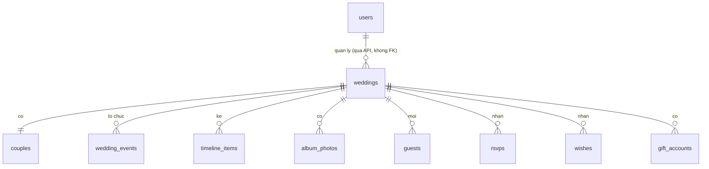

# Database — Online Wedding Invitation

MySQL 8.0 · Database `wedding_db` · Engine InnoDB · Charset `utf8mb4` /
`utf8mb4_unicode_ci` (tiếng Việt có dấu, emoji ♥) · Múi giờ `+07:00`.

File SQL: `database/schema.sql` (tạo bảng), `database/seed.sql` (dữ liệu demo).
Cách chạy xem `database/README.md`.

> **Schema này khớp 1-1 với JPA entity backend** (`backend/src/main/java/com/wedding/entity/`,
> Spring PhysicalNamingStrategy: camelCase → snake_case, tên bảng lấy từ `@Table`).
> Backend chạy với `ddl-auto: update` nên Hibernate tự tạo/cập nhật bảng theo entity;
> file SQL dùng khi khởi tạo MySQL bằng tay. Đã đồng bộ ngày 14/11/2026 (bản trước lệch
> tên cột ở `users`, `weddings`, `couples`, `wedding_events`, `guests`, `rsvps`,
> `gift_accounts` — đã sửa schema/seed theo entity, vì entity là hệ thống đang chạy).

## Danh sách bảng (10 bảng)

| Bảng | Mục đích | Khóa chính | Khóa ngoại |
| --- | --- | --- | --- |
| `users` | Tài khoản quản trị | `id` | — |
| `weddings` | Một đám cưới = một thiệp | `id` | — |
| `couples` | Cô dâu / chú rể (1 dòng / wedding) | `id` | `wedding_id` → `weddings` (UNIQUE) |
| `wedding_events` | Sự kiện lễ / tiệc | `id` | `wedding_id` → `weddings` |
| `timeline_items` | Mốc câu chuyện tình yêu | `id` | `wedding_id` → `weddings` |
| `album_photos` | Ảnh album cưới | `id` | `wedding_id` → `weddings` |
| `guests` | Khách mời | `id` | `wedding_id` → `weddings` |
| `rsvps` | Xác nhận tham dự | `id` | `wedding_id` → `weddings` |
| `wishes` | Lời chúc của khách | `id` | `wedding_id` → `weddings` |
| `gift_accounts` | Tài khoản nhận quà mừng | `id` | `wedding_id` → `weddings` |

Tất cả id đều là `BIGINT AUTO_INCREMENT`. Tất cả bảng con tham chiếu
`weddings` đều `ON DELETE CASCADE` — xóa wedding là xóa sạch dữ liệu của
thiệp đó.

## Chi tiết từng bảng

### users

Tài khoản đăng nhập Admin. `role` lưu dạng `ROLE_ADMIN` (như entity `User`).

| Cột | Kiểu | Ràng buộc | Ghi chú |
| --- | --- | --- | --- |
| `id` | BIGINT | PK, AUTO_INCREMENT | |
| `email` | VARCHAR(150) | NOT NULL, UNIQUE | Đăng nhập bằng email |
| `password` | VARCHAR(255) | NOT NULL | BCrypt hash, **do backend tạo** — không ghi tay vào SQL |
| `full_name` | VARCHAR(150) | NULL | |
| `role` | VARCHAR(30) | NOT NULL, DEFAULT `'ROLE_ADMIN'` | |
| `enabled` | TINYINT(1) | NOT NULL, DEFAULT 1 | `0` = khóa tài khoản |
| `created_at` | TIMESTAMP | NULL | |
| `updated_at` | TIMESTAMP | NULL | |

### weddings

Tên cô dâu/chú rể nằm ở bảng `couples` (quan hệ 1-1), không nằm ở đây.

| Cột | Kiểu | Ràng buộc | Ghi chú |
| --- | --- | --- | --- |
| `id` | BIGINT | PK, AUTO_INCREMENT | |
| `slug` | VARCHAR(200) | NOT NULL, UNIQUE | Định danh URL, vd: `thanh-truc-xuan-yen` |
| `title` | VARCHAR(255) | NOT NULL | Vd: `Thanh Trúc & Xuân Yên` |
| `wedding_date` | DATE | NOT NULL | Vd: `2026-01-03` |
| `ceremony_time` | TIME | NULL | Giờ Lễ Thành Hôn, vd: `09:00:00` |
| `reception_time` | TIME | NULL | Giờ Tiệc Cưới, vd: `18:00:00` |
| `venue_name` | VARCHAR(255) | NULL | Vd: `White Palace Hoàng Văn Thụ` |
| `venue_address` | VARCHAR(500) | NULL | Vd: `194 Hoàng Văn Thụ, Phú Nhuận, TP. Hồ Chí Minh` |
| `music_url` | VARCHAR(500) | NULL | Nhạc nền (mp3) |
| `template` | VARCHAR(100) | NOT NULL, DEFAULT `'thiep-cuoi-hien-dai'` | Mã template hiển thị |
| `greeting_message` | TEXT | NULL | Lời chào / lời mời trên thiệp |
| `created_at` | TIMESTAMP | NULL | |
| `updated_at` | TIMESTAMP | NULL | |

### couples

Mỗi wedding có đúng **1 dòng**, chứa cả cô dâu và chú rể,
ràng buộc bằng `UNIQUE (wedding_id)`.

| Cột | Kiểu | Ràng buộc | Ghi chú |
| --- | --- | --- | --- |
| `id` | BIGINT | PK, AUTO_INCREMENT | |
| `wedding_id` | BIGINT | NOT NULL, UNIQUE, FK → `weddings(id)` CASCADE | |
| `bride_name` | VARCHAR(150) | NOT NULL | Cô dâu, vd: `Thanh Trúc` |
| `groom_name` | VARCHAR(150) | NOT NULL | Chú rể, vd: `Xuân Yên` |
| `bride_bio` | TEXT | NULL | Giới thiệu cô dâu |
| `groom_bio` | TEXT | NULL | Giới thiệu chú rể |
| `bride_photo_url` | VARCHAR(500) | NULL | |
| `groom_photo_url` | VARCHAR(500) | NULL | |
| `monogram` | VARCHAR(50) | NULL | Vd: `T ♥ Y` |
| `display_name` | VARCHAR(255) | NULL | Tên hiển thị, vd: `Thanh Trúc & Xuân Yên` (nữ trước) |
| `created_at` | TIMESTAMP | NULL | |
| `updated_at` | TIMESTAMP | NULL | |

### wedding_events

`event_type`: `CEREMONY` = Lễ Thành Hôn, `RECEPTION` = Tiệc Cưới.

| Cột | Kiểu | Ràng buộc | Ghi chú |
| --- | --- | --- | --- |
| `id` | BIGINT | PK, AUTO_INCREMENT | |
| `wedding_id` | BIGINT | NOT NULL, FK → `weddings(id)` CASCADE | |
| `title` | VARCHAR(200) | NOT NULL | Vd: `Lễ Thành Hôn`, `Tiệc Cưới` |
| `event_type` | VARCHAR(50) | NULL | `CEREMONY` / `RECEPTION` |
| `event_date` | DATE | NOT NULL | Vd: `2026-01-03` |
| `start_time` | TIME | NULL | Vd: `09:00:00` |
| `end_time` | TIME | NULL | Vd: `11:00:00` |
| `location` | VARCHAR(255) | NULL | Vd: `White Palace Hoàng Văn Thụ` |
| `address` | VARCHAR(500) | NULL | Vd: `194 Hoàng Văn Thụ, Phú Nhuận` |
| `description` | TEXT | NULL | |
| `sort_order` | INT | NOT NULL, DEFAULT 0 | |
| `created_at` | TIMESTAMP | NULL | |
| `updated_at` | TIMESTAMP | NULL | |

### timeline_items

| Cột | Kiểu | Ràng buộc | Ghi chú |
| --- | --- | --- | --- |
| `id` | BIGINT | PK, AUTO_INCREMENT | |
| `wedding_id` | BIGINT | NOT NULL, FK → `weddings(id)` CASCADE | |
| `title` | VARCHAR(255) | NOT NULL | |
| `description` | TEXT | NULL | |
| `event_date` | DATE | NULL | Ngày của mốc kỷ niệm |
| `image_url` | VARCHAR(500) | NULL | |
| `sort_order` | INT | NOT NULL, DEFAULT 0 | Hiển thị theo `sort_order` tăng dần |
| `created_at` | TIMESTAMP | NULL | |
| `updated_at` | TIMESTAMP | NULL | |

### album_photos

| Cột | Kiểu | Ràng buộc | Ghi chú |
| --- | --- | --- | --- |
| `id` | BIGINT | PK, AUTO_INCREMENT | |
| `wedding_id` | BIGINT | NOT NULL, FK → `weddings(id)` CASCADE | |
| `image_url` | VARCHAR(500) | NOT NULL | |
| `caption` | VARCHAR(255) | NULL | |
| `sort_order` | INT | NOT NULL, DEFAULT 0 | |
| `created_at` | TIMESTAMP | NULL | |
| `updated_at` | TIMESTAMP | NULL | |

### guests

| Cột | Kiểu | Ràng buộc | Ghi chú |
| --- | --- | --- | --- |
| `id` | BIGINT | PK, AUTO_INCREMENT | |
| `wedding_id` | BIGINT | NOT NULL, FK → `weddings(id)` CASCADE | |
| `full_name` | VARCHAR(150) | NOT NULL | |
| `phone` | VARCHAR(30) | NULL | |
| `email` | VARCHAR(150) | NULL | |
| `group_name` | VARCHAR(100) | NULL | Vd: `Gia đình`, `Bạn thân`, `Đồng nghiệp` |
| `invited_count` | INT | NOT NULL, DEFAULT 1 | Số người được mời đi kèm |
| `notes` | TEXT | NULL | |
| `created_at` | TIMESTAMP | NULL | |
| `updated_at` | TIMESTAMP | NULL | |

### rsvps

Khách RSVP bằng tên + SĐT, **không có `guest_id`** — không bắt buộc phải có
trong danh sách `guests` (khớp entity `Rsvp`).

| Cột | Kiểu | Ràng buộc | Ghi chú |
| --- | --- | --- | --- |
| `id` | BIGINT | PK, AUTO_INCREMENT | |
| `wedding_id` | BIGINT | NOT NULL, FK → `weddings(id)` CASCADE | |
| `guest_name` | VARCHAR(150) | NOT NULL | Tên người xác nhận |
| `phone` | VARCHAR(30) | NULL | |
| `email` | VARCHAR(150) | NULL | |
| `attending` | TINYINT(1) | NOT NULL, DEFAULT 1 | `1` = tham dự, `0` = không tham dự |
| `guest_count` | INT | NOT NULL, DEFAULT 1 | Số người đi (tính cả bản thân) |
| `message` | TEXT | NULL | Lời nhắn kèm RSVP |
| `created_at` | TIMESTAMP | NULL | |
| `updated_at` | TIMESTAMP | NULL | |

### wishes

| Cột | Kiểu | Ràng buộc | Ghi chú |
| --- | --- | --- | --- |
| `id` | BIGINT | PK, AUTO_INCREMENT | |
| `wedding_id` | BIGINT | NOT NULL, FK → `weddings(id)` CASCADE | |
| `sender_name` | VARCHAR(150) | NOT NULL | |
| `message` | TEXT | NOT NULL | |
| `approved` | TINYINT(1) | NOT NULL, DEFAULT 0 | `0` = chờ duyệt, `1` = đã duyệt (mới hiện public) |
| `created_at` | TIMESTAMP | NULL | |
| `updated_at` | TIMESTAMP | NULL | |

### gift_accounts

`side`: `BRIDE` = cô dâu, `GROOM` = chú rể.

| Cột | Kiểu | Ràng buộc | Ghi chú |
| --- | --- | --- | --- |
| `id` | BIGINT | PK, AUTO_INCREMENT | |
| `wedding_id` | BIGINT | NOT NULL, FK → `weddings(id)` CASCADE | |
| `account_holder` | VARCHAR(150) | NOT NULL | Tên chủ tài khoản |
| `bank_name` | VARCHAR(100) | NOT NULL | Vd: `Vietcombank`, `Techcombank` |
| `account_number` | VARCHAR(50) | NOT NULL | ⚠ Số trong seed là **SỐ MẪU** |
| `branch` | VARCHAR(150) | NULL | Chi nhánh ngân hàng |
| `qr_code_url` | VARCHAR(500) | NULL | Ảnh QR chuyển khoản |
| `side` | VARCHAR(20) | NULL | `BRIDE` / `GROOM` |
| `sort_order` | INT | NOT NULL, DEFAULT 0 | |
| `created_at` | TIMESTAMP | NULL | |
| `updated_at` | TIMESTAMP | NULL | |

## Sơ đồ ER



Dạng text (quan hệ 1–nhiều, trung tâm là `weddings`):

```
users ── (quản trị qua API, không có FK) ──> weddings (1)
weddings (1) ──|| couples           (đúng 1 dòng: bride_* + groom_*)
weddings (1) ──< wedding_events     (vd: Lễ Thành Hôn, Tiệc Cưới)
weddings (1) ──< timeline_items     (sắp xếp theo sort_order)
weddings (1) ──< album_photos       (sắp xếp theo sort_order)
weddings (1) ──< guests             (invited_count, notes)
weddings (1) ──< rsvps              (RSVP bằng tên + SĐT, không gắn guest)
weddings (1) ──< wishes             (approved = 1 mới hiện public)
weddings (1) ──< gift_accounts      (side: BRIDE / GROOM)
```

### Vì sao thiết kế như vậy

- **Một wedding, một slug.** Mọi dữ liệu public đều truy vấn theo `slug`
  (`GET /api/public/weddings/{slug}`), mọi dữ liệu admin theo `wedding_id`.
  Thêm wedding mới không cần sửa code hay thêm bảng — đây là cách hệ thống
  mở rộng thành nhiều thiệp (xem `docs/architecture.md`).
- **`users` không FK tới `weddings`.** Giai đoạn này một admin quản lý mọi
  wedding. Nếu sau này cần phân quyền theo wedding, thêm bảng trung gian
  `user_weddings (user_id, wedding_id)` thay vì sửa các bảng hiện có.
- **`couples` 1 dòng / wedding.** Cô dâu và chú rể là hai nửa của cùng một
  cặp đôi nên gom vào một dòng (`bride_*` / `groom_*`) thay vì hai dòng
  `role` — đơn giản hơn cho API `WeddingResponse` (trả cả cặp trong một object).
- **Giờ lễ / tiệc nằm ở `weddings`.** `ceremony_time` / `reception_time` để
  trang thiệp lấy nhanh giờ chính; `wedding_events` giữ chi tiết từng sự kiện
  (kể cả sự kiện ngoài lễ/tiệc chính).
- **RSVP không gắn `guest_id`.** Khách vãng lai vẫn RSVP được bằng tên + SĐT;
  việc đối chiếu với danh sách mời làm bằng tên/email ở tầng Admin nếu cần.
- **`wishes.approved` mặc định `false`.** Chống spam: lời chúc chỉ hiện
  public sau khi admin duyệt (API approve/reject).
- **Xóa cascade.** Xóa một wedding thì toàn bộ dữ liệu con bị xóa theo.
- **Index:** `UNIQUE` trên `users.email`, `weddings.slug` và `couples.wedding_id`;
  index trên mọi `wedding_id` (truy vấn theo wedding là truy vấn chính);
  index trên `email` ở `users`, `guests`, `rsvps` (tìm kiếm / đối chiếu khách).
- **DB mặc định:** `wedding_db` (docker-compose override qua `SPRING_DATASOURCE_URL`;
  `application.yml` của backend mặc định `wedding_invitation` nếu chạy tay không
  set env — nên set `SPRING_DATASOURCE_URL` cho khớp).

## Seed data (`database/seed.sql`)

Seed demo cho wedding `thanh-truc-xuan-yen` (chạy lại được):

| Bảng | Số dòng | Nội dung |
| --- | --- | --- |
| `weddings` | 1 | Thanh Trúc & Xuân Yên, `2026-01-03`, Lễ 09:00, Tiệc 18:00, White Palace Hoàng Văn Thụ, template `thiep-cuoi-hien-dai` |
| `couples` | 1 | Thanh Trúc & Xuân Yên, monogram `T ♥ Y`, display `Thanh Trúc & Xuân Yên` |
| `wedding_events` | 2 | Lễ Thành Hôn 09:00–11:00 (CEREMONY), Tiệc Cưới 18:00–21:00 (RECEPTION), White Palace Hoàng Văn Thụ, 194 Hoàng Văn Thụ, Phú Nhuận |
| `timeline_items` | 4 | Gặp nhau 14/02/2019, tỏ tình 20/06/2021, cầu hôn 24/12/2024, ăn hỏi 15/11/2025 |
| `album_photos` | 6 | Ảnh placeholder `picsum.photos/seed/thanh-truc-xuan-yen-N/800/600` |
| `gift_accounts` | 3 | Vietcombank + MB Bank (cô dâu), Techcombank (chú rể) — **SỐ MẪU** |
| `guests` | 5 | Bố mẹ hai bên, bạn thân, đồng nghiệp |
| `rsvps` | 3 | 2 tham dự (2 + 1 người), 1 không tham dự |
| `wishes` | 4 | 2 đã duyệt, 2 chờ duyệt |
| `users` | 0 | **Không seed trong SQL** — admin `admin@wedding.local` / `Admin@123` do backend `DataSeeder` tạo lúc chạy |

Lưu ý khi dùng seed:

- Ngày cưới, địa điểm, bio, timeline trong seed là **dữ liệu demo**,
  sửa được qua trang Admin — không cần sửa SQL rồi chạy lại.
- Ảnh album/timeline là placeholder `picsum.photos` — thay bằng ảnh cưới thật
  qua Admin (album/timeline API) trước khi gửi thiệp.
- **Số tài khoản là SỐ MẪU** (`1903123456`, `1903123457`, `1903765432`).
  Đổi sang số thật qua Admin (gift-accounts API) trước khi gửi thiệp cho khách.
- Chạy lại `seed.sql` sẽ **xóa và chèn lại** toàn bộ dữ liệu của wedding
  `thanh-truc-xuan-yen` (kể cả RSVP / lời chúc khách đã gửi cho wedding này).
  Wedding khác không bị ảnh hưởng.
